# Nayan Tara: all system flows

Every flow in one file. The same content is split into one file per flow in this folder (see [README.md](README.md)); this file includes all of them.

## Contents

**Basics**

- [Big picture](#big-picture)
- [Coins and balance](#coins-and-balance)

**Portal**

- [Signing in to the portal](#signing-in-to-the-portal)
- [Roles and access](#roles-and-access)
- [School tools for admins](#school-tools-for-admins)
- [School and house settings](#school-and-house-settings)
- [Bulk student import](#bulk-student-import)
- [Export a record](#export-a-record)

**Calls and money**

- [Starting a call](#starting-a-call)
- [Call states](#call-states)
- [Call length](#call-length)
- [Ending and charging a call](#ending-and-charging-a-call)
- [Parent recharge](#parent-recharge)
- [Parent activation fee](#parent-activation-fee)
- [Weekly minute allotment](#weekly-minute-allotment)

**Reference**

- [App endpoints](#app-endpoints)

---

## Big picture

Three front ends talk to one Node API, which owns the MySQL database. The API also sends call notifications through Firebase, takes payments through PhonePe and runs the weekly allotment job.

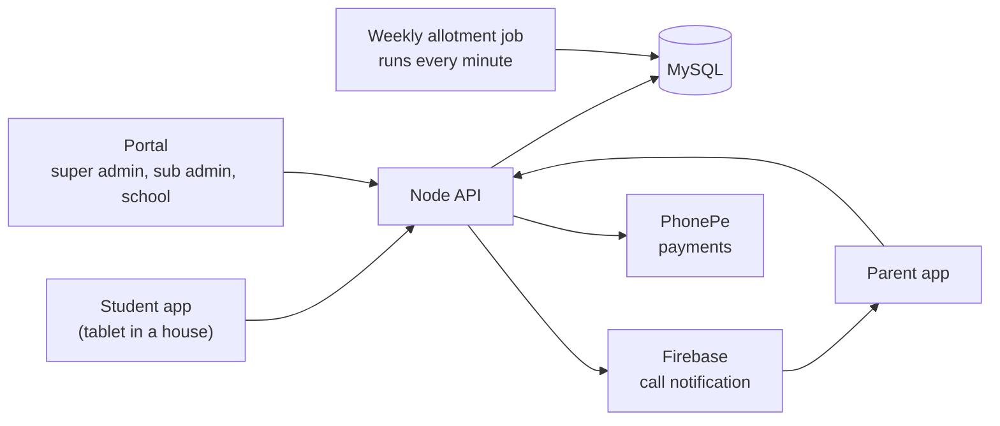

### Rules

- A **school** is a row in `tbl_franchise`. A **house** is a row in `tbl_department` and belongs to one school.
- Each student belongs to one school and one house. Each parent is linked to one student.
- The house's **Device ID** is the tablet the students of that house use.

| Part | Where |
|---|---|
| Portal (PHP) | `super_admin/*.php`, `include/` |
| API (Node) | `nayantara/` |
| Rules for calls, recharge, activation, allotment | `nayantara/models/call_rules.js` |
| Portal sign-in and sub admins | `nayantara/models/auth.js`, `include/auth.php` |

---

## Coins and balance

Balances are stored as **seconds of talk time** in `total_talktime`, on the student and copied on each of the student's parents. **1 Spacs Coin = 1 minute of balance.**

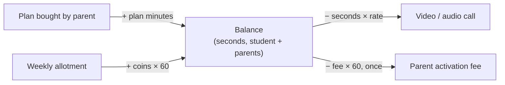

| Thing | How it becomes balance | Example |
|---|---|---|
| Plan bought by a parent | Plan minutes added to the student and the parents | 30 min plan → +1800 s |
| Video call | Seconds talked × school video rate | 100 s at 1.5 → −150 s |
| Audio call | Seconds talked × school audio rate | 100 s at 1.0 → −100 s |
| Parent activation fee | Fee coins × 60, once per parent | 2 coins → −120 s |
| Weekly allotment | (video min × video rate + audio min × audio rate) × 60 | 10 + 5 min → +1200 s |

### Rules

- Deductions never take a positive balance below 0. A balance that is already negative is left as it is.
- Every change is applied to the student and to all of that student's parents, so both apps show the same balance.

---

## Signing in to the portal

There is one login page for everyone (`/`). The email decides the role.

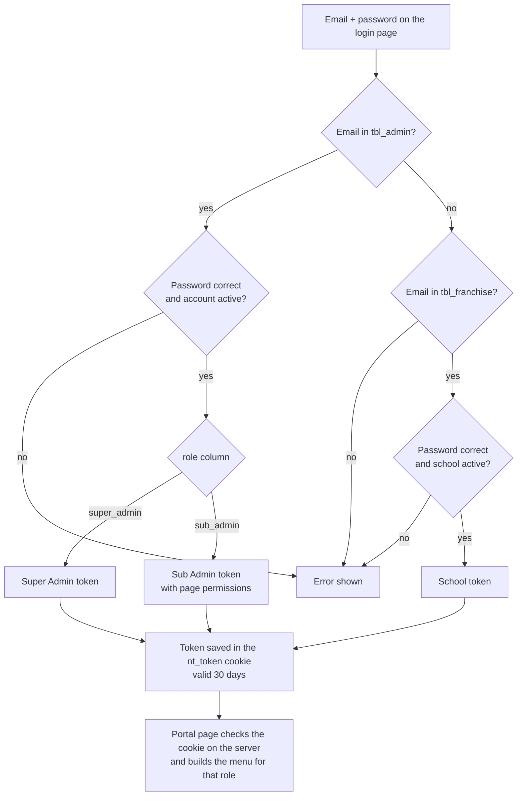

### Rules

- API: `POST /api/portal-login`. Code: `nayantara/models/auth.js`, `include/auth.php`, `super_admin/login.php`.
- Each portal page is checked on the server before it loads. No valid cookie sends you to the login page. A page you can't open sends you to your first allowed page.
- An email can belong to only one login. Creating a school or sub admin with an email that is already used is refused.
- Sub admin passwords are stored encrypted. Existing admin and school passwords still work as before.
- Old `/franchise/...` page links redirect to the login page.

---

## Roles and access

| Role | Who | Sees | Data |
|---|---|---|---|
| **Super Admin** | Owner account | Every admin page, School Tools and Sub Admins | All schools |
| **Sub Admin** | Staff created on the Sub Admins page | Only the pages ticked for them, each as View or Manage | All schools |
| **School** | The email + password set on the school | The old franchise pages: Dashboard, Students, Parents, Transactions, Call History, Skip Data | Their own school only |

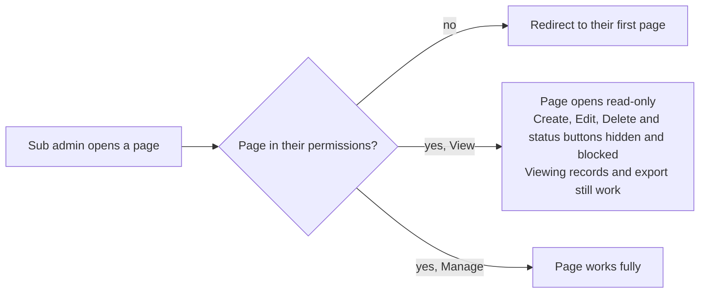

### Rules

- The super admin creates sub admins on **Administration → Sub Admins** and sets each page to No access, View or Manage.
- Changes to a sub admin's access take effect the next time they sign in.
- School logins are listed on the Sub Admins page too; their email, password and active status are edited on the school itself.
- The page list lives in `nt_pages()` in `include/auth.php`.

> **Limit:** the portal controls which pages and buttons a sub admin can use. The data API itself does not check logins yet, so someone calling the API directly is not stopped.

---

## School tools for admins

The pages that came from the franchise portal (student and parent import, skip data) work on one school at a time. A school account is already scoped to itself. An admin picks a school first.

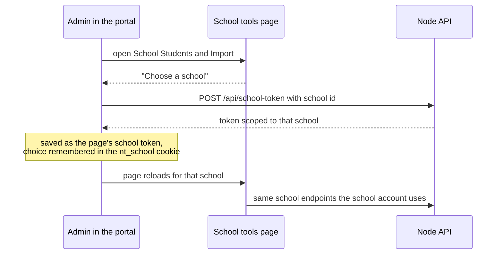

### Rules

- Pages: `super_admin/school_*.php`.
- A sub admin needs at least one School Tools page in their permissions to get a school token.
- The school selector stays at the top of the page so the admin can switch schools.

---

## School and house settings

Set on the **Schools** and **Houses** pages in the portal. Missing database columns are added automatically when the API starts.

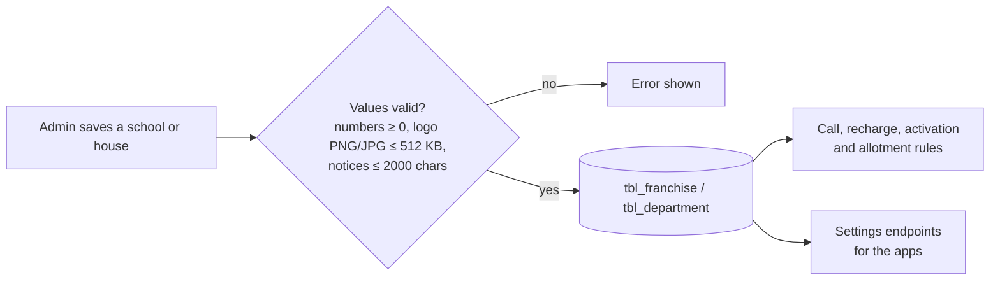

| Setting | Level | Default | Where it is enforced |
|---|---|---|---|
| Logo | School | None | Returned to the apps by the settings endpoints |
| Allow parental recharge | School | On | [Parent recharge](#parent-recharge) |
| Allow audio calls | School | On | [Starting a call](#starting-a-call) |
| Video rate / audio rate | School | 1 coin/min each | [Call length](#call-length), [charging](#ending-and-charging-a-call), [allotment](#weekly-minute-allotment) |
| Parent activation fee | School | 0 | [Activation fee](#parent-activation-fee) |
| Max calls per day | School | 0 = unlimited | [Starting a call](#starting-a-call) |
| Daily duration allowance | School | 0 = unlimited | [Starting a call](#starting-a-call), [call length](#call-length) |
| Min call duration to count | School | 30 s | Shorter calls don't count towards the two daily limits |
| Max call duration | House | 120 s (0 = unlimited) | [Call length](#call-length) |
| Allotment day, time, weekly video and audio minutes | House | Sunday 07:00 IST, 0 min | [Weekly allotment](#weekly-minute-allotment) |
| Parent notice, student notice | House | Empty, up to 2000 characters | [App endpoints](#app-endpoints) |
| Calling time slots | House | Set per day | [Starting a call](#starting-a-call) |

The defaults keep the old behaviour, so nothing changes for a school until someone edits its settings.

---

## Bulk student import

From the super admin **Students** page there is no school to pick: each row's `department_id` (house ID) decides the school. From a school's own Students page, the school is fixed.

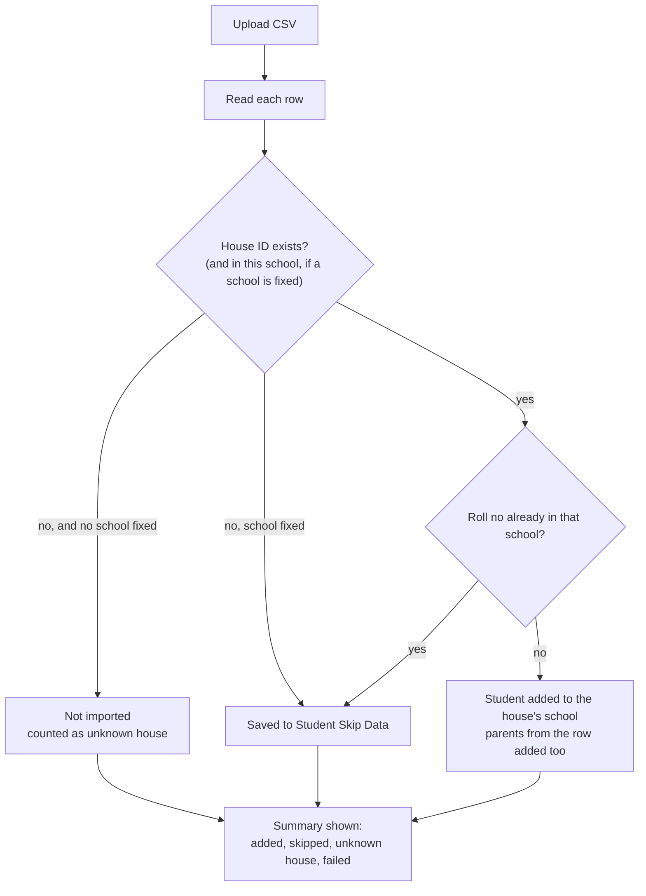

### Rules

- API: `POST /import-csv` (code in `nayantara/app.js`, `uploadCsv`).
- CSV columns: name, roll no, password, house ID, contact, three reference fields, default plan, auto recharge, then up to five parent name and contact pairs. Sample: `assets/student.csv`.
- The house ID is the ID column on the Houses page.
- The import writes `other_ref_1`–`3`, `defaultplan` and `autorecharge` on `tbl_student`; a database without those columns can't save new students (counted as failed).

---

## Export a record

Clicking any student, parent, school or house in the portal opens its details panel. The download button exports that one record as a CSV.

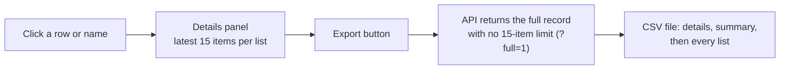

| Record | Lists in the export |
|---|---|
| Student | Parents, calls, plans, payments, tickets |
| Parent | Calls, plans, tickets |
| School | Houses, plans, all students, all parents, plus the school settings |
| House | Students, their parents, plus the house settings |

### Rules

- API: `GET /api/lookup/{student|parent|franchise|department}/:id?full=1`. Code: `nayantara/models/lookup.js`, `assets/admin/js/nt-lookup.js`.
- Phone numbers and roll numbers with a leading zero are kept as text so Excel doesn't change them.

---

## Starting a call

The student taps a parent on the tablet. The app calls `POST /api/firebase/notification` with the parent id and `call_type` (`audio` or `video`; video if missing).

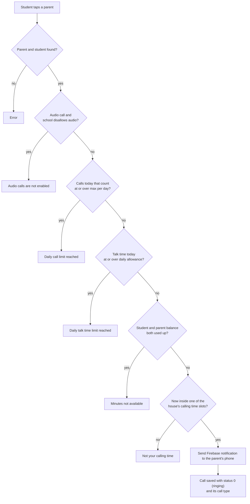

### Rules

- "Calls today that count" means ended calls today that lasted at least the school's minimum call duration.
- A limit set to 0 is not checked.
- Code: `fcmToken` in `nayantara/models/student/student_fcmtoken.js`, `callBlockReason` in `nayantara/models/call_rules.js`.

---

## Call states

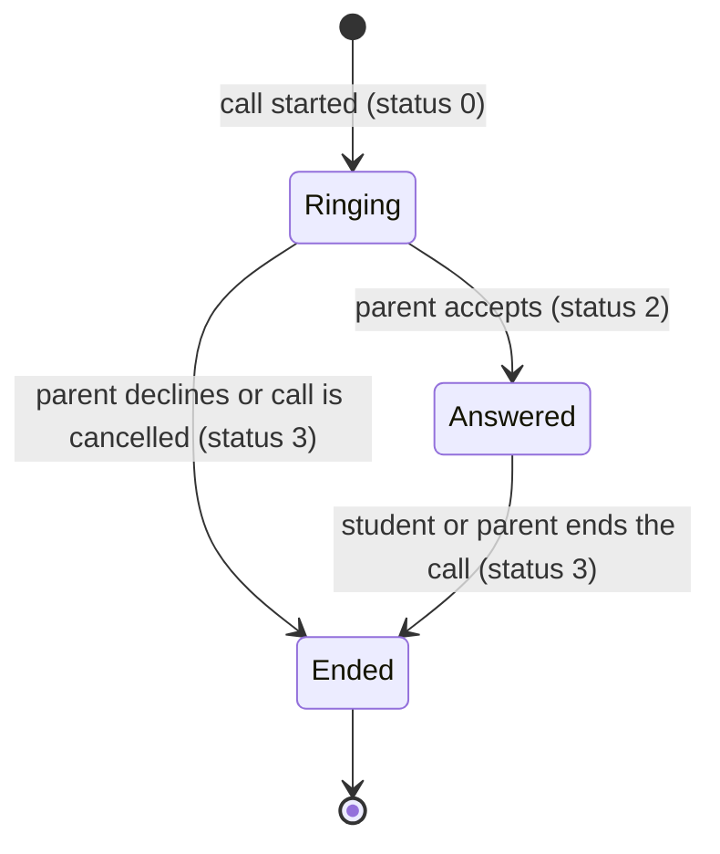

| Status | Meaning | Set by |
|---|---|---|
| 0 | Ringing | Call start (`/api/firebase/notification`) |
| 2 | Answered | Parent accepts (`/parent/status-updateparent`) |
| 3 | Ended | Parent declines, call cancelled (`/parent/parent-calldefuse`), or call ended |

### Rules

- Only a call that goes from Answered to Ended is charged, and only once even if both apps report the end.
- A declined or unanswered call costs nothing.

---

## Call length

Before the call, the app asks `POST /api/get-callminute` how long this call may last, and disconnects at that point.

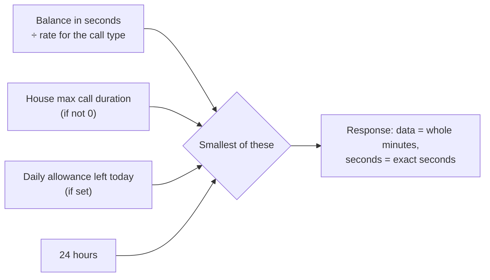

### Example

600 s balance, video at 1.5 coins/min, house cap 120 s → **120 s**.
With the house cap at 0 → **400 s** for video, **600 s** for audio.

### Rules

- Send `call_type` (`audio` / `video`) so the right rate is used.
- `data` is whole minutes and shows 0 when less than a minute is left; use `seconds` for the exact limit.
- Code: `callMinute` in `student_fcmtoken.js`, `allowedCallSeconds` in `call_rules.js`.

---

## Ending and charging a call

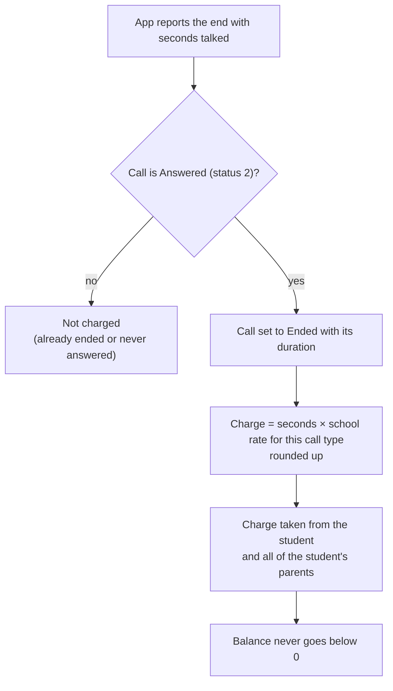

### Rules

- Endpoints: `POST /api/statusupdate-callhistory` (student), `POST /parent/parent-callend` (parent), `POST /api/update-min`.
- If the school settings can't be read, the raw seconds are charged.
- Code: `callCharge` in `nayantara/models/call_rules.js`.

---

## Parent recharge

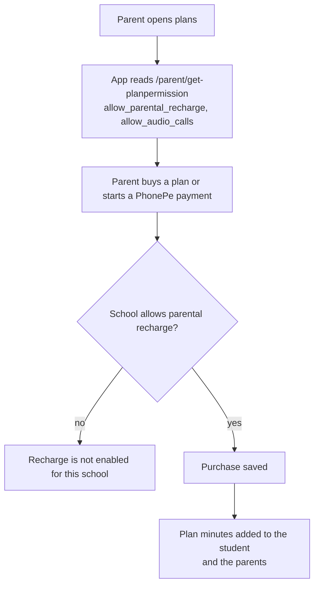

### Rules

- Blocked endpoints when recharge is off: `POST /parent/planpurchase/parent`, `POST /api/phonepe-payement`.
- Code: `rechargeBlockReason` in `nayantara/models/call_rules.js`.

---

## Parent activation fee

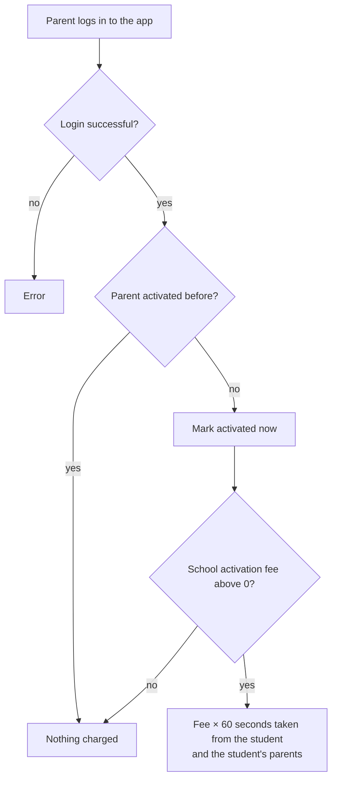

### Rules

- Parents who existed before this feature were marked as already activated (`activated_at`), so only new parents can be charged.
- The fee is charged once per parent, even if two logins happen at the same moment.
- Code: `activateParent` in `nayantara/models/call_rules.js`, called from parent login.

---

## Weekly minute allotment

A job inside the API runs every minute and credits each house once on its chosen day, at or after its chosen time (India time).

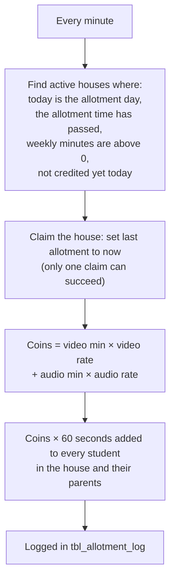

### Example

10 video minutes at 1.5 and 5 audio minutes at 1 → 20 coins → **+1200 s** for every student in the house.

### Rules

- If the API was down at the allotment time, the credit happens when it comes back the same day.
- **Allot now:** the edit house form has an "Allot now" button that credits the house's saved weekly minutes immediately (super admin, or sub admin with manage access to Houses). It is an extra credit: the weekly schedule still runs. Logged with `source = 'manual'` (the weekly job logs `auto`).
- Code: `runAllotments` and `allotNow` (`POST /api/allot-now/:id`) in `nayantara/models/call_rules.js`, the job started from `nayantara/app.js`.

---

## App endpoints

What the student and parent apps call for these rules.

| Endpoint | Used for |
|---|---|
| `POST /api/firebase/notification` | Start a call. Send `call_type`: audio or video. |
| `POST /api/get-callminute` | How long the next call may last (`data` minutes, `seconds`). |
| `POST /parent/status-updateparent` | Parent accepts (2) or declines (3) a ringing call. |
| `POST /api/statusupdate-callhistory` | Student ends a call; charges it. |
| `POST /parent/parent-callend` | Parent ends a call; charges it. |
| `POST /parent/get-planpermission` | Whether recharge and audio calls are allowed. |
| `POST /parent/planpurchase/parent` | Buy a plan (blocked when recharge is off). |
| `GET /api/student-settings/:studentId` | School and house settings, logo URL, both notices, today's calls and seconds. |
| `GET /api/device-settings/:deviceId` | The same for a tablet before anyone logs in (student login screen notice). |

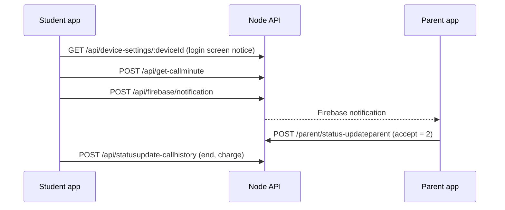
