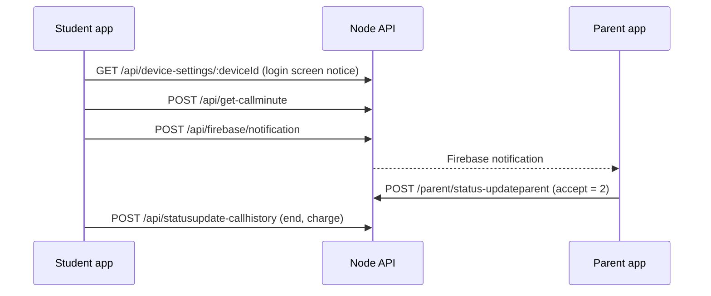

# App endpoints

What the student and parent apps call for these rules.

| Endpoint | Used for |
|---|---|
| `POST /api/firebase/notification` | Start a call. Send `call_type`: audio or video. |
| `POST /api/get-callminute` | How long the next call may last (`data` minutes, `seconds`). |
| `POST /parent/status-updateparent` | Parent accepts (2) or declines (3) a ringing call. |
| `POST /api/statusupdate-callhistory` | Student ends a call; charges it. |
| `POST /parent/parent-callend` | Parent ends a call; charges it. |
| `POST /parent/get-planpermission` | Whether recharge and audio calls are allowed. |
| `POST /parent/planpurchase/parent` | Buy a plan (blocked when recharge is off). |
| `GET /api/student-settings/:studentId` | School and house settings, logo URL, both notices, today's calls and seconds. |
| `GET /api/device-settings/:deviceId` | The same for a tablet before anyone logs in (student login screen notice). |

