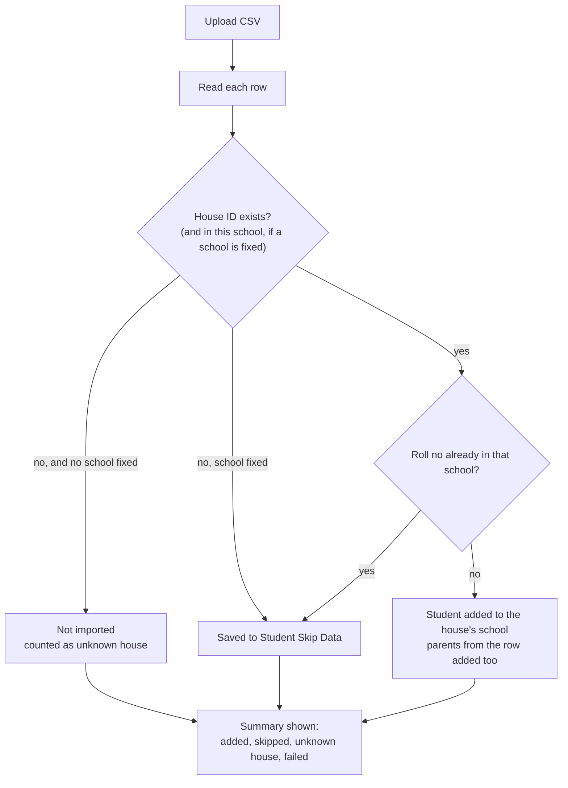

# Bulk student import

From the super admin **Students** page there is no school to pick: each row's `department_id` (house ID) decides the school. From a school's own Students page, the school is fixed.

## Rules

- API: `POST /import-csv` (code in `nayantara/app.js`, `uploadCsv`).
- CSV columns: name, roll no, password, house ID, contact, three reference fields, default plan, auto recharge, then up to five parent name and contact pairs. Sample: `assets/student.csv`.
- The house ID is the ID column on the Houses page.
- The import writes `other_ref_1`–`3`, `defaultplan` and `autorecharge` on `tbl_student`; a database without those columns can't save new students (counted as failed).
