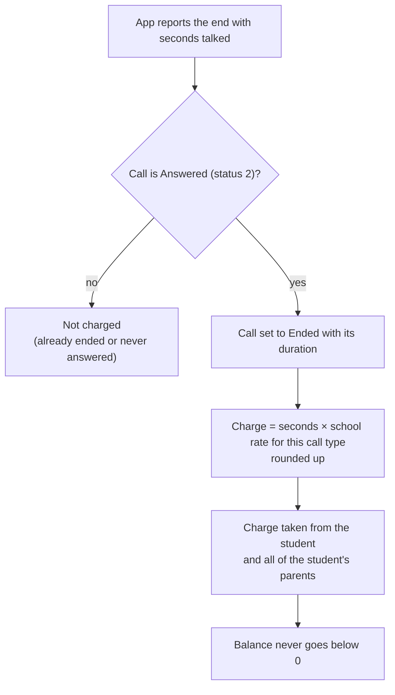

# Ending and charging a call

## Rules

- Endpoints: `POST /api/statusupdate-callhistory` (student), `POST /parent/parent-callend` (parent), `POST /api/update-min`.
- If the school settings can't be read, the raw seconds are charged.
- Code: `callCharge` in `nayantara/models/call_rules.js`.
