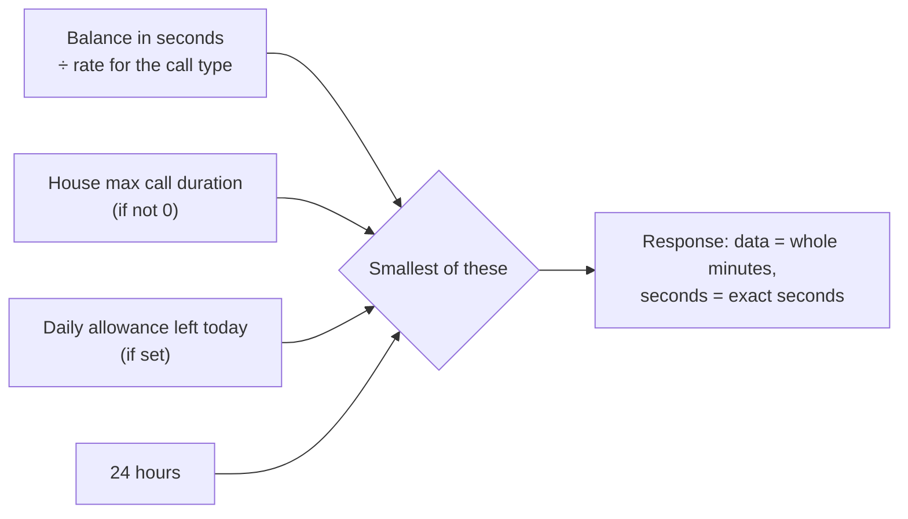

# Call length

Before the call, the app asks `POST /api/get-callminute` how long this call may last, and disconnects at that point.

## Example

600 s balance, video at 1.5 coins/min, house cap 120 s → **120 s**.
With the house cap at 0 → **400 s** for video, **600 s** for audio.

## Rules

- Send `call_type` (`audio` / `video`) so the right rate is used.
- `data` is whole minutes and shows 0 when less than a minute is left; use `seconds` for the exact limit.
- Code: `callMinute` in `student_fcmtoken.js`, `allowedCallSeconds` in `call_rules.js`.
