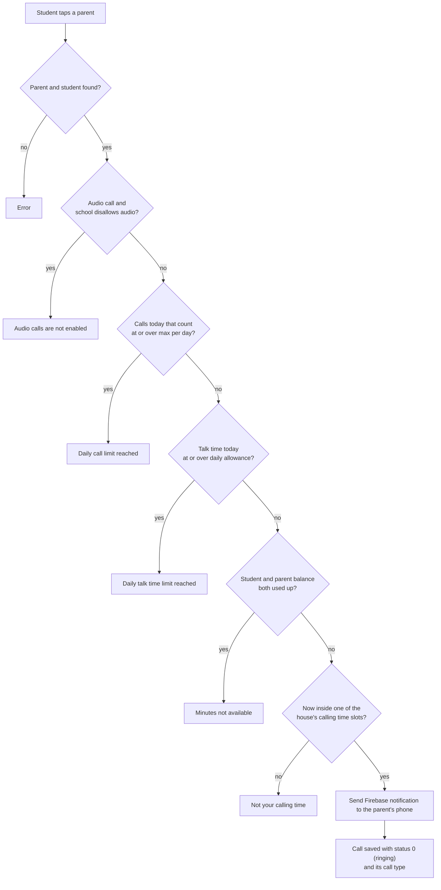

# Starting a call

The student taps a parent on the tablet. The app calls `POST /api/firebase/notification` with the parent id and `call_type` (`audio` or `video`; video if missing).

## Rules

- "Calls today that count" means ended calls today that lasted at least the school's minimum call duration.
- A limit set to 0 is not checked.
- Code: `fcmToken` in `nayantara/models/student/student_fcmtoken.js`, `callBlockReason` in `nayantara/models/call_rules.js`.
