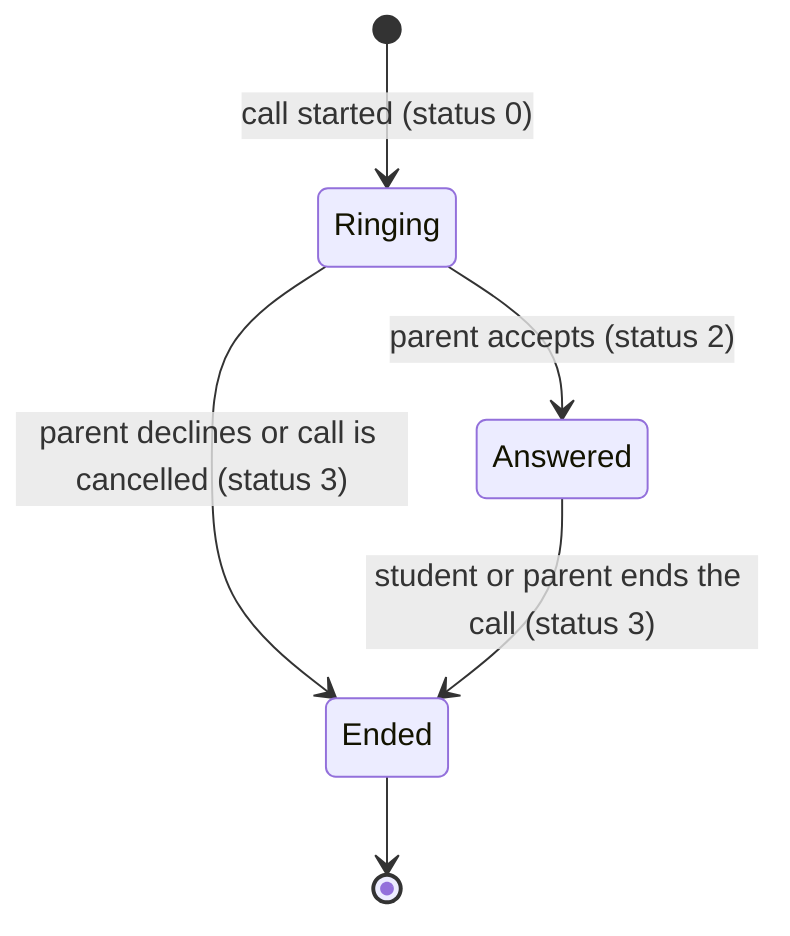

# Call states

| Status | Meaning | Set by |
|---|---|---|
| 0 | Ringing | Call start (`/api/firebase/notification`) |
| 2 | Answered | Parent accepts (`/parent/status-updateparent`) |
| 3 | Ended | Parent declines, call cancelled (`/parent/parent-calldefuse`), or call ended |

## Rules

- Only a call that goes from Answered to Ended is charged, and only once even if both apps report the end.
- A declined or unanswered call costs nothing.
