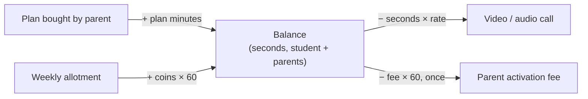

# Coins and balance

Balances are stored as **seconds of talk time** in `total_talktime`, on the student and copied on each of the student's parents. **1 Spacs Coin = 1 minute of balance.**

| Thing | How it becomes balance | Example |
|---|---|---|
| Plan bought by a parent | Plan minutes added to the student and the parents | 30 min plan → +1800 s |
| Video call | Seconds talked × school video rate | 100 s at 1.5 → −150 s |
| Audio call | Seconds talked × school audio rate | 100 s at 1.0 → −100 s |
| Parent activation fee | Fee coins × 60, once per parent | 2 coins → −120 s |
| Weekly allotment | (video min × video rate + audio min × audio rate) × 60 | 10 + 5 min → +1200 s |

## Rules

- Deductions never take a positive balance below 0. A balance that is already negative is left as it is.
- Every change is applied to the student and to all of that student's parents, so both apps show the same balance.
