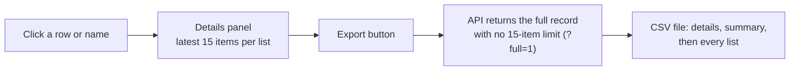

# Export a record

Clicking any student, parent, school or house in the portal opens its details panel. The download button exports that one record as a CSV.

| Record | Lists in the export |
|---|---|
| Student | Parents, calls, plans, payments, tickets |
| Parent | Calls, plans, tickets |
| School | Houses, plans, all students, all parents, plus the school settings |
| House | Students, their parents, plus the house settings |

## Rules

- API: `GET /api/lookup/{student|parent|franchise|department}/:id?full=1`. Code: `nayantara/models/lookup.js`, `assets/admin/js/nt-lookup.js`.
- Phone numbers and roll numbers with a leading zero are kept as text so Excel doesn't change them.
