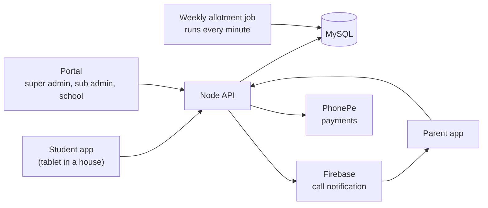

# Big picture

Three front ends talk to one Node API, which owns the MySQL database. The API also sends call notifications through Firebase, takes payments through PhonePe and runs the weekly allotment job.

## Rules

- A **school** is a row in `tbl_franchise`. A **house** is a row in `tbl_department` and belongs to one school.
- Each student belongs to one school and one house. Each parent is linked to one student.
- The house's **Device ID** is the tablet the students of that house use.

| Part | Where |
|---|---|
| Portal (PHP) | `super_admin/*.php`, `include/` |
| API (Node) | `nayantara/` |
| Rules for calls, recharge, activation, allotment | `nayantara/models/call_rules.js` |
| Portal sign-in and sub admins | `nayantara/models/auth.js`, `include/auth.php` |
