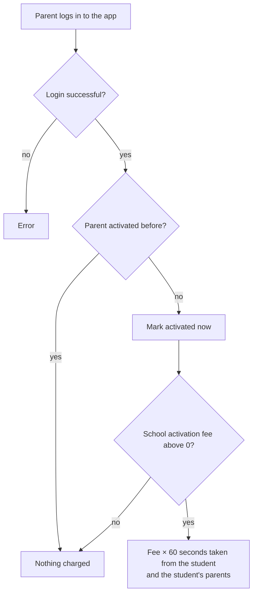

# Parent activation fee

## Rules

- Parents who existed before this feature were marked as already activated (`activated_at`), so only new parents can be charged.
- The fee is charged once per parent, even if two logins happen at the same moment.
- Code: `activateParent` in `nayantara/models/call_rules.js`, called from parent login.
