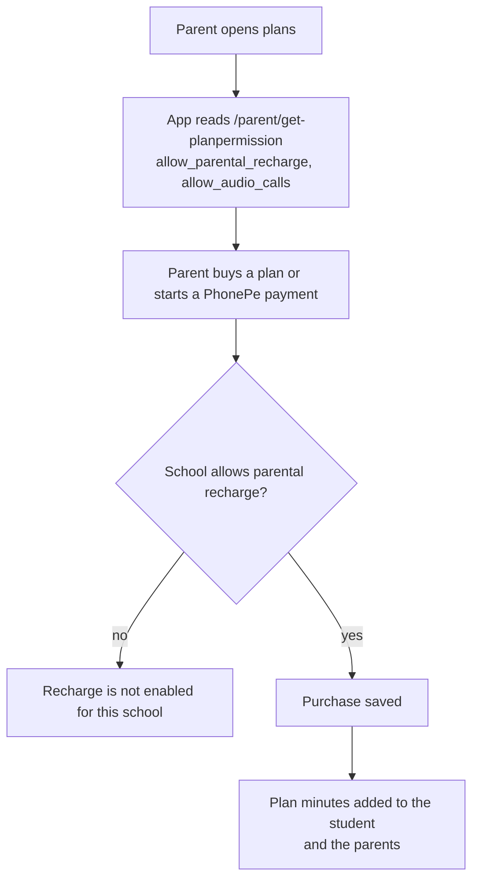

# Parent recharge

## Rules

- Blocked endpoints when recharge is off: `POST /parent/planpurchase/parent`, `POST /api/phonepe-payement`.
- Code: `rechargeBlockReason` in `nayantara/models/call_rules.js`.
