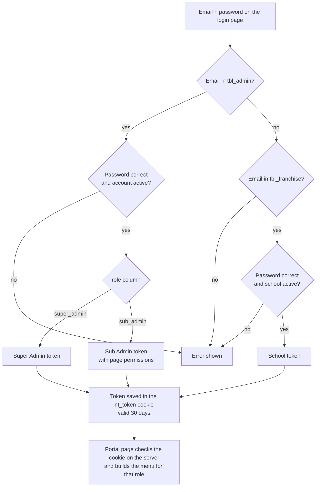

# Signing in to the portal

There is one login page for everyone (`/`). The email decides the role.

## Rules

- API: `POST /api/portal-login`. Code: `nayantara/models/auth.js`, `include/auth.php`, `super_admin/login.php`.
- Each portal page is checked on the server before it loads. No valid cookie sends you to the login page. A page you can't open sends you to your first allowed page.
- An email can belong to only one login. Creating a school or sub admin with an email that is already used is refused.
- Sub admin passwords are stored encrypted. Existing admin and school passwords still work as before.
- Old `/franchise/...` page links redirect to the login page.
