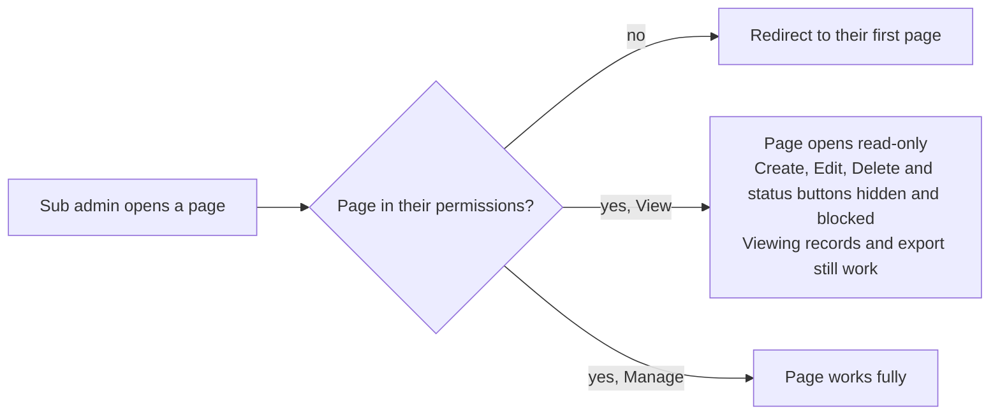

# Roles and access

| Role | Who | Sees | Data |
|---|---|---|---|
| **Super Admin** | Owner account | Every admin page, School Tools and Sub Admins | All schools |
| **Sub Admin** | Staff created on the Sub Admins page | Only the pages ticked for them, each as View or Manage | All schools |
| **School** | The email + password set on the school | The old franchise pages: Dashboard, Students, Parents, Transactions, Call History, Skip Data | Their own school only |

## Rules

- The super admin creates sub admins on **Administration → Sub Admins** and sets each page to No access, View or Manage.
- Changes to a sub admin's access take effect the next time they sign in.
- School logins are listed on the Sub Admins page too; their email, password and active status are edited on the school itself.
- The page list lives in `nt_pages()` in `include/auth.php`.

> **Limit:** the portal controls which pages and buttons a sub admin can use. The data API itself does not check logins yet, so someone calling the API directly is not stopped.
