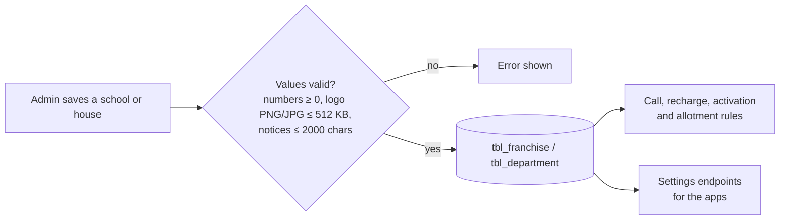

# School and house settings

Set on the **Schools** and **Houses** pages in the portal. Missing database columns are added automatically when the API starts.

| Setting | Level | Default | Where it is enforced |
|---|---|---|---|
| Logo | School | None | Returned to the apps by the settings endpoints |
| Allow parental recharge | School | On | [Parent recharge](parent-recharge.md) |
| Allow audio calls | School | On | [Starting a call](call-start.md) |
| Video rate / audio rate | School | 1 coin/min each | [Call length](call-length.md), [charging](call-end-and-charging.md), [allotment](weekly-allotment.md) |
| Parent activation fee | School | 0 | [Activation fee](parent-activation-fee.md) |
| Max calls per day | School | 0 = unlimited | [Starting a call](call-start.md) |
| Daily duration allowance | School | 0 = unlimited | [Starting a call](call-start.md), [call length](call-length.md) |
| Min call duration to count | School | 30 s | Shorter calls don't count towards the two daily limits |
| Max call duration | House | 120 s (0 = unlimited) | [Call length](call-length.md) |
| Allotment day, time, weekly video and audio minutes | House | Sunday 07:00 IST, 0 min | [Weekly allotment](weekly-allotment.md) |
| Parent notice, student notice | House | Empty, up to 2000 characters | [App endpoints](app-endpoints.md) |
| Calling time slots | House | Set per day | [Starting a call](call-start.md) |

The defaults keep the old behaviour, so nothing changes for a school until someone edits its settings.
