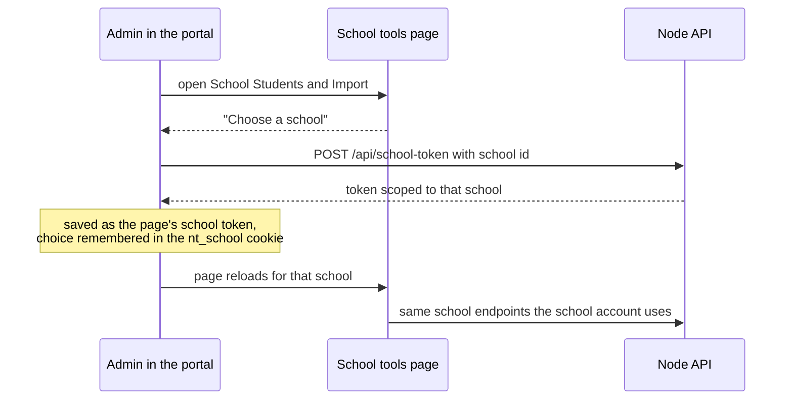

# School tools for admins

The pages that came from the franchise portal (student and parent import, skip data) work on one school at a time. A school account is already scoped to itself. An admin picks a school first.

## Rules

- Pages: `super_admin/school_*.php`.
- A sub admin needs at least one School Tools page in their permissions to get a school token.
- The school selector stays at the top of the page so the admin can switch schools.
