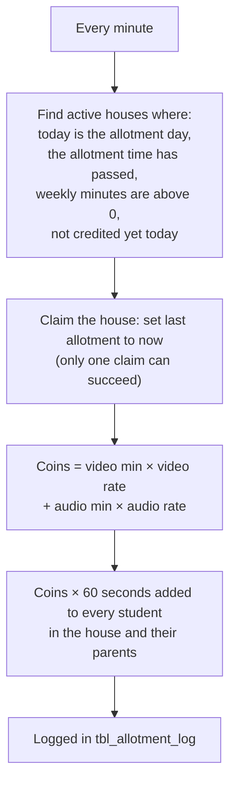

# Weekly minute allotment

A job inside the API runs every minute and credits each house once on its chosen day, at or after its chosen time (India time).

## Example

10 video minutes at 1.5 and 5 audio minutes at 1 → 20 coins → **+1200 s** for every student in the house.

## Rules

- If the API was down at the allotment time, the credit happens when it comes back the same day.
- Code: `runAllotments` in `nayantara/models/call_rules.js`, started from `nayantara/app.js`.
